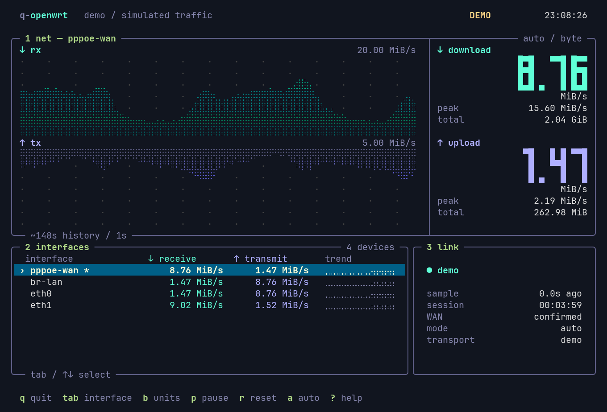

# q-openwrt

通过 SSH 实时查看 OpenWrt 网速的终端软件。只需要本机 Python 3.10+（含 curses）和 OpenSSH，路由器无需安装额外软件。支持在 Linux / macOS 终端运行；Windows 可使用 WSL。

## 启动

```sh
q-openwrt root@192.168.1.1
```

首次连接由系统 SSH 提示确认主机密钥、输入密码；也支持 SSH 密钥、ssh-agent 和 `~/.ssh/config` 中的主机别名。密码不存储在项目或配置文件中。不传地址时默认连接 `root@192.168.1.1`。

```sh
q-openwrt --demo                          # 无需路由器，预览模拟流量
q-openwrt openwrt                         # 使用 SSH 配置中的别名
q-openwrt root@192.168.1.1 -i pppoe-wan   # 指定接口
q-openwrt root@192.168.1.1 -n 0.5 --bits  # 每 0.5 秒采样，显示 bit/s
q-openwrt root@192.168.1.1 -p 2222 --identity ~/.ssh/id_ed25519
q-openwrt --local                         # 读取本机 Linux 网卡
q-openwrt --once                          # 输出一次真实速率 JSON
q-openwrt --batch --once                  # 无提示模式，适合 SSH 密钥登录
```

`bin/common/q-openwrt` 使用 dotfiles 的标准 Python runner 启动本目录的 `q-openwrt.py`，无需安装第三方库或虚拟环境。dotfiles 的 shell 配置已将 `bin/common` 加入 PATH，也支持 `DOTFILES_DIR` 和符号链接入口；zsh 参数补全位于 `zsh/completions/_q-openwrt`。

也可以直接执行 `python3 ~/.dotfiles/module/q-openwrt/q-openwrt.py --help`。

## 界面与快捷键

界面参考 [btop](https://github.com/aristocratos/btop) 的终端风格：圆角细线面板、蓝色边框、薄荷绿下载曲线、淡紫色上传曲线、上下镜像 Braille 图，以及高亮的网卡列表。右侧集中显示当前速率、峰值和会话流量；宽窗口额外显示连接状态。窗口高度允许时采用三行大数字显示速率。

**默认隐藏 `sit0` 和 `lo`**，网卡列表和自动选择均排除这两个接口。推荐终端大小 110×34，最小 68×23；小窗口会提示调整大小。支持 256 色，并为 16 色终端和非 UTF-8 环境提供降级显示。界面采用英文标签，避免中文字符在不同终端中的宽度兼容问题。

以下预览使用真实界面绘制代码和模拟流量生成：



| 按键 | 功能 |
| --- | --- |
| `Tab` / `↓` / `j` | 下一个接口 |
| `Shift-Tab` / `↑` / `k` | 上一个接口 |
| `a` | 恢复自动选择 WAN |
| `b` | 切换 B/s 与 bit/s |
| `p` / 空格 | 暂停界面刷新，后台仍采样 |
| `r` | 清空会话统计、峰值和历史 |
| `?` / `h` | 显示帮助 |
| `q` / `Esc` | 退出 |

## 统计口径

- 通过 `ubus call network.interface dump` 查找启用的 `wan`、`wan6` 或具有默认路由的接口，优先使用 `l3_device`；每次采样更新识别结果。多个 WAN 分别查看，不自动相加。
- 在 **WAN** 上，RX 表示下载、TX 表示上传；在 LAN 桥上方向相反。未获得 ubus 确认的接口只显示 RECEIVE / TRANSMIT，并标记 WAN 未确认。
- 读取 `/proc/net/dev` 的字节计数器，用差值除以路由器 `/proc/uptime` 时间差得到速率。首次采样建立基线，第二次开始有速率。SSH 传输延迟不会作为采样间隔。
- `KiB/s`、`MiB/s` 使用 1024；`Kbit/s`、`Mbit/s` 使用 1000。1 B = 8 bit。
- 会话流量仅累计软件运行期间成功采到的增量；不是路由器开机以来的总流量。接口重建、计数器重置或重连时重新建立基线，断线期间流量不计入会话统计。
- 趋势图保存最近 240 个样本，UTF-8 环境下以每字符两次采样、四个纵向像素的 Braille 图显示；下载、上传上下镜像，纵轴分档自动缩放。图底部标注可见样本约覆盖的时间，断线期间不补数据。
- 兼容不支持小数秒 `sleep` 的 OpenWrt：优先改用 `usleep`；两者均不支持时，向上取整到整秒。趋势图标注实际测得的采样间隔。
- 不把 `pppoe-wan`、`eth1`、`br-lan` 相加，避免同一批数据在不同网络层重复计算。不同接口包含的链路开销也会不同。
- 采集使用一条持续 SSH 连接，只执行读取命令。SSH 流量本身也会被网卡计数器计入。

## 连接问题

登录在 TUI 启动前完成，之后采样使用 SSH 连接复用。断线后按 1、2、4、8、15 秒间隔重试，密钥登录可自动重新认证。密码登录时，若复用连接也失效，需要退出后重新运行以输入密码。软件不会在后台保存或重放密码。

如果 SSH 报系统配置 `Bad owner or permissions`，可先修复 SSH 配置权限，或临时指定独立配置文件：

```sh
q-openwrt root@192.168.1.1 --ssh-config /dev/null
```

`--ssh-config /dev/null` 会跳过现有 SSH 配置，包括主机别名、代理和密钥等设置；直连 IP 时可用，必要时显式传 `--identity` 和 `-p`。软件遵循 OpenSSH 的主机密钥检查，不会自动绕过校验。

若提示缺少 curses，安装发行版提供的 Python curses 支持。`--local` 模式要求 Linux 的 `/proc`；直接在 OpenWrt 上运行也需要路由器已经安装 Python 及 curses，因此推荐在电脑上通过 SSH 使用。

## 开发验证

在 dotfiles 仓库根目录运行：

```sh
python3 -m unittest discover -s module/q-openwrt/tests -v
q-openwrt --demo --once -n 0.2
q-openwrt --local --once -n 0.2
```

预览生成工具 `tools/render_preview.py` 仅用于开发，需要 Pillow 和 fontconfig；命令运行本身没有这些依赖。
